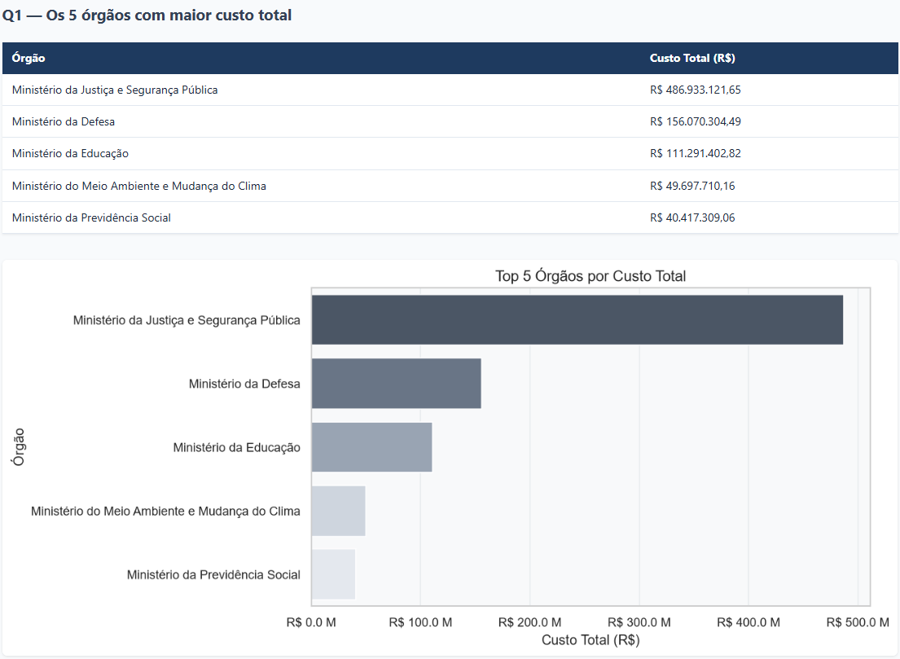
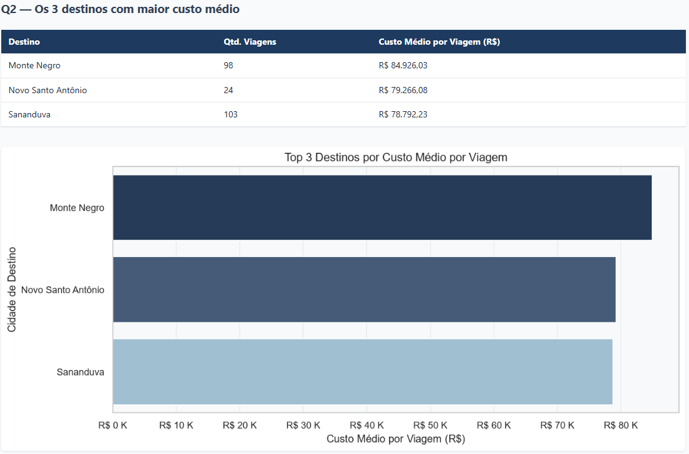
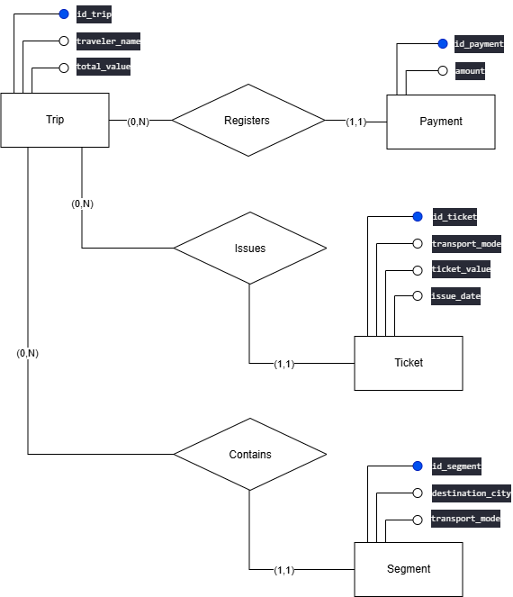
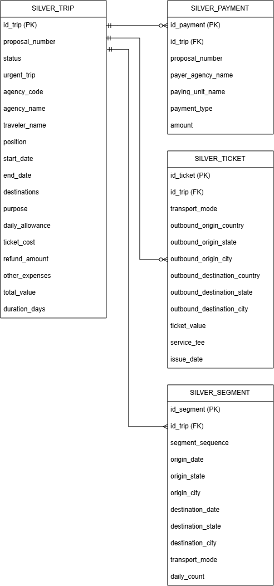

  
  
  
  
  

  # Pipeline de Dados — Viagens a Serviço (Portal da Transparência)

  ## 📌 O Problema
  O Governo Federal disponibiliza dados abertos sobre viagens a serviço no Portal da Transparência. No entanto, esses dados chegam em sua forma bruta, desorganizados e propensos a inconsistências, o que dificulta a tomada de decisão e a auditoria.

  Este projeto resolve esse problema construindo um **pipeline de dados de ponta a ponta (ETL)** utilizando a **Arquitetura Medallion** (camadas Raw, Silver e Gold). O objetivo é extrair os dados diretamente da fonte, limpá-los, garantir a integridade referencial e transformá-los em métricas e visualizações que respondam a perguntas de negócio reais.

  ## 🏗️ Arquitetura e Tecnologias
  O pipeline foi construído utilizando **Python**, **PostgreSQL**, **SQLAlchemy** e **Pandas**.

  *   **Camada Raw (Bruta):** Cópia fiel dos arquivos CSV. Todas as colunas são importadas como `VARCHAR` para preservar a integridade histórica e permitir auditoria.
  *   **Camada Silver (Limpa):** Dados tipados (`DECIMAL`, `DATE`), com aplicação de regras de negócio (cálculo de custo total e dias de duração) e constraints de integridade (Primary Keys, Foreign Keys e Checks).
  *   **Camada Gold (Analítica):** Agregações, `JOIN`s e `VIEW`s prontas para consumo, além de um Jupyter Notebook com as respostas visuais para as perguntas de negócio.

  ### 🔒 Constraints Extras (8 no total, conforme enunciado)

  | Tabela | Constraint 1 | Constraint 2 |
  | :--- | :--- | :--- |
  | `silver_trip` | `agency_name` NOT NULL | `daily_allowance` CHECK >= 0 |
  | `silver_payment` | `amount` CHECK >= 0 | `payment_type` NOT NULL |
  | `silver_ticket` | `ticket_value` CHECK >= 0 | `service_fee` CHECK >= 0 |
  | `silver_segment` | `daily_count` CHECK >= 0 | UNIQUE(`id_trip`, `segment_sequence`) |

  ### ⚙️ Convenções de Idioma
  O projeto adota **inglês** para o **schema do banco de dados** e para o
  **código-fonte Python** (variáveis, funções, classes, docstrings e logs),
  seguindo as boas práticas do mercado internacional de engenharia de
  dados e alinhado ao objetivo do curso de preparar profissionais para
  atuar globalmente. A escolha foi **acordada previamente com o professor**.

  Assim, os nomes de tabelas (`silver_trip`, `silver_payment`,
  `silver_ticket`, `silver_segment`), colunas (`daily_allowance`,
  `total_value`, `duration_days`), tabelas analíticas (`gold_payment_types`,
  `gold_transport_modes`, etc.) e views (`vw_gold_*`) estão em **inglês**.

  Exceções deliberadas:
  - **Documentação e Relatórios** (README, células de texto do Jupyter, relatórios HTML) estão em **português**, para facilitar a leitura pela banca avaliadora e pelo público-alvo do projeto (gestores públicos e cidadãos brasileiros).
  - **Código-fonte e Comentários no Código** (variáveis, funções, docstrings, comentários `#` no Python e SQL) estão em **inglês**, seguindo o padrão internacional de Engenharia de Software.
  - **Dados em si** permanecem no idioma original da fonte (português, conforme publicado pelo Portal da Transparência).

  Essa separação — **código em inglês, documentação em português** — é
  intencional e reflete a prática comum em equipes de dados que atendem
  stakeholders locais mas desenvolvem software com padrões internacionais.

  O projeto foi desenhado seguindo os três níveis clássicos de modelagem de dados:

  ## 📊 Visualizações (Prévia dos Relatórios)

  Abaixo, uma prévia visual dos insights extraídos dos dados de viagens. Os relatórios executivos completos, formatados e prontos para leitura estão disponíveis na seção [Documentação Adicional](#-documentação-adicional) ao longo deste documento.

  | Top 5 Órgãos por Custo | Top 3 Destinos por Custo Médio |
  | :---: | :---: |
  |  |  |

  ## 📂 Estrutura do Repositório
  ```text
  ├── data/                 # Pasta gerada automaticamente pelos scripts (ignorada pelo Git)
  │   └── raw/              # Onde o .zip e os arquivos CSV são salvos
  ├── docs/   
  │   ├── enunciado.pdf     # Documento original do projeto (regras e requisitos)
  │   ├── relatorio_analise_BR.html   # Relatório em Português (gerado por 3_analise_BR.py)
  │   ├── relatorio_analise_EN.html   # Relatório em Inglês (gerado por 3_analise_EN.py)
  │   ├── preview_q1.png                # Screenshots para o README
  │   ├── preview_q2.png                # Screenshots para o README
  │   ├── modelo_conceitual_dark.png
  │   ├── modelo_conceitual_light.png
  │   ├── modelo_logico_dark.png
  │   └── modelo_logico_light.png
  ├── outputs/              # Pasta gerada automaticamente (ignorada pelo Git)
  │   ├── pipeline.log      # Log de execução completo do pipeline
  │   ├── relatorio_analise_EN.md        # Subproduto local do 3_analise_EN.py
  │   └── figures/          # Gráficos PNG em inglês (gerados por 3_analise_EN.py)
  │       ├── q1_top_agencies.png
  │       ├── q2_top_destinations.png
  │       ├── q3_longest_trip.png
  │       ├── q4_payment_types.png
  │       ├── q5_transport_modes.png
  │       ├── q6_destination_states.png
  │       └── q7_top_payers.png
  ├── reports/              # Scripts geradores de relatório (Portfólio)
  │   ├── 3_analise_BR.py   # Gerador do relatório PT-BR
  │   └── 3_analise_EN.py   # Gerador do relatório EN
  ├── .env.example          # Modelo de variáveis de ambiente
  ├── .gitignore            # Arquivos ignorados pelo Git
  ├── 0_criar_banco.py      # Script para criar o DB e as tabelas via SQL
  ├── 0_criar_banco.sql     # DDL com a modelagem (PKs, FKs, Constraints)
  ├── 1_extrair.py          # Download, extração e carga na camada Raw
  ├── 2_transformar.py      # Limpeza, tipagem e carga na camada Silver
  ├── 3_analise.ipynb       # Análise, gráficos e criação da camada Gold
  ├── run_pipeline.py       # Orquestrador que executa todas as etapas do pipeline
  ├── banco.py              # Utilitários de conexão com o banco
  ├── config.py             # Configurações e mapeamentos de colunas
  ├── requirements.txt      # Dependências do projeto
  └── README.md             # Documentação
  ```

  > **Sobre o `3_analise_EN.py`:** este script gera uma versão **reprodutível**
  > do relatório em inglês (`outputs/relatorio_analise_EN.md` + PNGs). Ele serve
  > para quem clonar o repositório **regenerar a análise localmente** com um
  > único comando. O relatório **deliverable** (já renderizado, com narrativa
  > completa) está em [`docs/relatorio_analise_EN.html`](docs/relatorio_analise_EN.html).
  >
  > **Pastas `data/` e `outputs/`:** são geradas automaticamente e não são
  > versionadas (ver `.gitignore`). Aparecem na árvore apenas para documentar
  > o que será criado após rodar `python run_pipeline.py` e
  > `python 3_analise_EN.py`.

  ## 🚀 Como Executar

  ### 1. Pré-requisitos
  *   Python 3.10+
  *   PostgreSQL instalado e rodando.

  ### 2. Configuração do Ambiente
  Clone o repositório e crie um ambiente virtual:
  ```bash
  python -m venv .venv
  source .venv/bin/activate  # Windows: .\.venv\Scripts\Activate.ps1
  ```

  Instale as dependências:
  ```bash
  pip install -r requirements.txt
  ```

  ### 3. Variáveis de Ambiente

  Para manter as credenciais seguras e o código limpo, o projeto utiliza o padrão de variáveis de ambiente. O arquivo `.env` serve para armazenar dados sensíveis (como senhas) e configurações locais que não devem ser enviadas para o GitHub.

  Renomeie o arquivo `.env.example` (localizado na raiz do projeto) para `.env` 

  No Windows, você pode fazer isso pelo terminal com o comando:
  ```bash
  copy .env.example .env
  ```
  E preencha com os seus dados:

  ```env
  POSTGRES_HOST=localhost
  POSTGRES_PORT=5432
  POSTGRES_USER=postgres
  POSTGRES_PASSWORD=sua_senha
  POSTGRES_DATABASE=transparency
  POSTGRES_ADMIN_DB=postgres
  DRIVE_FILE_ID=seu_id_do_google_drive
  ```

  > **Como obter o `DRIVE_FILE_ID`:** 
  > O ID é o código único do arquivo `.zip` hospedado no Google Drive. Para encontrá-lo, abra o link de compartilhamento do arquivo (ex: `https://drive.google.com/file/d/1pQjKacyHdIsyteknQbwKGM5_4hL5V4RV/view?usp=sharing`). O ID é o trecho entre `/d/` e `/view` (no exemplo: `1pQjKacyHdIsyteknQbwKGM5_4hL5V4RV`).

  ### 4. Execução do Pipeline — Camadas Raw e Silver (ETL)

  O pipeline é **idempotente** (pode ser reexecutado várias vezes sem duplicar dados) e segue os princípios da Arquitetura Medallion. Para entender a esteira de dados, os arquivos têm as seguintes funções:

  *   **`0_criar_banco.py`:** Lê o arquivo `0_criar_banco.sql` e constrói o banco de dados e as 8 tabelas (Raw e Silver) com suas chaves e constraints.
  *   **`1_extrair.py`:** Baixa o arquivo `.zip` do Google Drive (se ainda não existir no computador), extrai os CSVs e carrega os dados brutos nas tabelas `raw_*` usando a função `COPY` (altíssima performance).
  *   **`2_transformar.py`:** Lê a camada Raw, limpa inconsistências (nulos e negativos), converte tipos (Data/Decimal), calcula métricas (custo e duração) e carrega nas tabelas `silver_*` respeitando a integridade referencial.
  *   **`3_analise.ipynb`:** Conecta ao banco, cria as tabelas e views agregadas (`gold_*`) e gera os gráficos finais que respondem às perguntas de negócio.

  Com base nisso, você pode executar o projeto de duas formas:

  **Opção A - Automatizada (Recomendado)**
  Execute o orquestrador que rodará todas as etapas em sequência:
  ```bash
  python run_pipeline.py
  ```
  *   **O que ele faz:** Roda os scripts `0_criar_banco.py`, `1_extrair.py` e `2_transformar.py` automaticamente. Ele salva um log completo de auditoria na pasta `outputs/` e imprime no terminal um resumo com a contagem de linhas de cada tabela. 
  *   *Nota: Após a execução, abra o arquivo `3_analise.ipynb` manualmente para visualizar os gráficos.*

  **Opção B - Manual (Passo a Passo)**
  Se preferir executar e validar cada camada separadamente, rode os scripts na ordem abaixo:
  ```bash
  python 0_criar_banco.py
  python 1_extrair.py
  python 2_transformar.py
  ```

  ### 5. Execução do Pipeline — Camada Gold (Análise de Dados)
  
  Com as camadas Raw e Silver populadas, a próxima etapa é a criação da camada Gold (agregações, views e métricas).
  Abra o arquivo `3_analise.ipynb` no VS Code ou Jupyter e execute todas as células. O notebook fará a conexão com o banco, criará as tabelas e views gold_* e exibirá os gráficos interativos com os insights de negócio.

  ### 6. Geração de Relatórios Executivos (Opcional)

  Para gerar os arquivos HTML independentes (com imagens embutidas em base64 e formatados para leitura executiva), execute os scripts da pasta `reports/`. 
  
  Os dois scripts geram o mesmo relatório, com os mesmos dados e gráficos, mas em idiomas diferentes:  
  *   **`3_analise_BR.py`**: Gera o relatório em **Português**.
  *   **`3_analise_EN.py`**: Gera o relatório em **Inglês**.

  ```bash
  python reports/3_analise_BR.py
  python reports/3_analise_EN.py
  ```
  Os relatórios finais serão salvos na pasta docs/  ([relatorio_analise_BR.html](docs/relatorio_analise_BR.html) e [relatorio_analise_EN.html](docs/relatorio_analise_EN.html)).

  *(Nota técnica: Para garantir alta performance no carregamento de mais de 300 mil registros, o pipeline utiliza `COPY FROM STDIN` na camada Raw e `psycopg2.extras.execute_values` na camada Silver, substituindo o lento `pandas.to_sql`).*

  *Atenção: rodar run_pipeline.py apaga o banco transparency existente*

  ### 🧩 Escolha do Driver `psycopg2-binary`

  O projeto utiliza o pacote `psycopg2-binary` por ser a opção recomendada para
  ambientes de desenvolvimento e avaliação, pois já inclui as bibliotecas C
  necessárias (`libpq`, `libssl`) e dispensa a instalação de compiladores ou
  cabeçalhos do PostgreSQL. Do ponto de vista do código Python, a interface é
  idêntica à do pacote `psycopg2` compilado a partir do código-fonte. Embora a
  documentação oficial do Psycopg recomende a versão compilada para cenários de
  produção em larga escala com alta concorrência, o `psycopg2-binary` atende
  plenamente aos requisitos deste pipeline de dados didático, garantindo
  instalação simples e portabilidade entre sistemas operacionais.

  ## 📄 Documentação Adicional

  **Relatórios Gerados:**
  *   [Relatório de Análise — Português (HTML)](docs/relatorio_analise.html)
  *   [Analysis Report — English (HTML)](docs/relatorio_analise_EN.html)

  **Código-fonte dos Geradores de Relatório (Reprodutibilidade):**
  *   [Gerador do Relatório PT-BR (`3_analise_BR.py`)](./reports/3_analise_BR.py)
  *   [Gerador do Relatório EN (`3_analise_EN.py`)](./reports/3_analise_EN.py)

  **Documentos do Projeto:**
  *   [Enunciado Oficial do Projeto](docs/M1S13-Projeto_Avaliativo_Módulo_1.pdf)

  ## 🗄️ Modelagem de Dados


  ### 1. Modelo Conceitual (Notação de Chen com Atributos)
  A entidade central do domínio é a **Viagem** (`Trip`). Uma viagem agrupa todas as despesas e deslocamentos de um servidor. A partir dela, derivam-se entidades dependentes:
  *   **Pagamentos (`Payments`):** Despesas financeiras atreladas à viagem.
  *   **Passagens (`Tickets`):** Bilhetes de transporte emitidos para a viagem.
  *   **Trechos (`Segments`):** O itinerário detalhado (origem, destino, datas).

  **Cardinalidade:** Uma Viagem (1) possui Vários (N) Pagamentos, Passagens e Trechos. (Relação 1:N).

  <picture>
    <source media="(prefers-color-scheme: dark)" srcset="docs/modelo_conceitual_dark.png">
    <source media="(prefers-color-scheme: light)" srcset="docs/modelo_conceitual_light.png">
    
  </picture>

  ### 2. Modelo Lógico
  O modelo lógico traduz o conceitual para tabelas relacionais, definindo Chaves Primárias (PK) e Estrangeiras (FK). A integridade referencial garante que um Pagamento, Passagem ou Trecho não exista sem uma Viagem associada.

  <picture>
    <source media="(prefers-color-scheme: dark)" srcset="docs/modelo_logico_dark.png">
    <source media="(prefers-color-scheme: light)" srcset="docs/modelo_logico_light.png">
    
  </picture>

  ### 3. Modelo Físico
  O modelo físico foi implementado no PostgreSQL. Toda a definição de DDL (Data Definition Language), contendo os tipos de dados exatos (VARCHAR, DECIMAL, DATE), chaves, regras de negócio (CHECK) e unicidade (UNIQUE), está no arquivo [0_criar_banco.sql](./0_criar_banco.sql). 

  ## 📖 Dicionário de Dados (Camada Silver)

  Abaixo estão detalhadas as estruturas das tabelas da camada Silver, contendo a tipagem estrita, chaves (PK/FK), constraints de validação e a descrição de negócio de cada campo.

  ### 1. Tabela: `silver_trip` (Viagens)
  | Coluna | Tipo | Restrições | Descrição / Regra de Negócio |
  | :--- | :--- | :--- | :--- |
  | `id_trip` | VARCHAR(50) | **PK**, NOT NULL | Identificador único do processo de viagem. |
  | `proposal_number` | VARCHAR(20) | | Número da Proposta (PCDP). |
  | `status` | VARCHAR(50) | | Situação da viagem (ex: Realizada, Cancelada). |
  | `urgent_trip` | VARCHAR(5) | | Indica se a viagem foi de caráter urgente. |
  | `agency_code` | VARCHAR(20) | | Código do órgão superior responsável. |
  | `agency_name` | VARCHAR(255) | **NOT NULL** | Nome do órgão superior. |
  | `traveler_name` | VARCHAR(255) | | Nome do servidor viajante. |
  | `position` | VARCHAR(255) | | Cargo do viajante. |
  | `start_date` | DATE | | Data de início da viagem (convertida de DD/MM/AAAA). |
  | `end_date` | DATE | | Data de fim da viagem (convertida de DD/MM/AAAA). |
  | `destinations` | VARCHAR(4000) | | Descrição dos destinos da viagem. |
  | `purpose` | VARCHAR(4000) | | Motivo/justificativa da viagem. |
  | `daily_allowance` | DECIMAL(10,2) | **CHECK >= 0** | Valor total pago em diárias. |
  | `ticket_cost` | DECIMAL(10,2) | | Valor total pago em passagens. |
  | `refund_amount` | DECIMAL(10,2) | | Valor devolvido pelo viajante. |
  | `other_expenses` | DECIMAL(10,2) | | Outros gastos atrelados à viagem. |
  | `total_value` | DECIMAL(12,2) | | **Calculado:** (Diárias + Passagens + Outros) - Devolução. |
  | `duration_days` | INT | | **Calculado:** Diferença em dias entre a data de fim e início (+1). |

  ### 2. Tabela: `silver_payment` (Pagamentos)
  | Coluna | Tipo | Restrições | Descrição / Regra de Negócio |
  | :--- | :--- | :--- | :--- |
  | `id_payment` | SERIAL | **PK** | Identificador único do pagamento (auto-incremento). |
  | `id_trip` | VARCHAR(50) | **FK**, NOT NULL | Chave estrangeira ligando o pagamento à viagem. |
  | `proposal_number` | VARCHAR(50) | | Número da proposta associada. |
  | `payer_agency_name` | VARCHAR(255) | | Nome do órgão pagador. |
  | `paying_unit_name` | VARCHAR(255) | | Nome da unidade gestora pagadora. |
  | `payment_type` | VARCHAR(50) | **NOT NULL** | Tipo de pagamento (ex: Diária, Passagem, etc.). |
  | `amount` | DECIMAL(10,2) | **CHECK >= 0** | Valor pago. |

  ### 3. Tabela: `silver_ticket` (Passagens)
  | Coluna | Tipo | Restrições | Descrição / Regra de Negócio |
  | :--- | :--- | :--- | :--- |
  | `id_ticket` | SERIAL | **PK** | Identificador único da passagem (auto-incremento). |
  | `id_trip` | VARCHAR(50) | **FK**, NOT NULL | Chave estrangeira ligando a passagem à viagem. |
  | `transport_mode` | VARCHAR(50) | | Meio de transporte (Aéreo, Rodoviário, etc.). |
  | `outbound_origin_country` | VARCHAR(80) | | País de origem do trecho de ida. |
  | `outbound_origin_state` | VARCHAR(80) | | UF de origem do trecho de ida. |
  | `outbound_origin_city` | VARCHAR(80) | | Cidade de origem do trecho de ida. |
  | `outbound_destination_country` | VARCHAR(80) | | País de destino do trecho de ida. |
  | `outbound_destination_state` | VARCHAR(80) | | UF de destino do trecho de ida. |
  | `outbound_destination_city` | VARCHAR(80) | | Cidade de destino do trecho de ida. |
  | `ticket_value` | DECIMAL(10,2) | **CHECK >= 0** | Valor da passagem. |
  | `service_fee` | DECIMAL(10,2) | **CHECK >= 0** | Taxa de serviço da emissão. |
  | `issue_date` | DATE | | Data de emissão da passagem. |

  ### 4. Tabela: `silver_segment` (Trechos)
  | Coluna | Tipo | Restrições | Descrição / Regra de Negócio |
  | :--- | :--- | :--- | :--- |
  | `id_segment` | SERIAL | **PK** | Identificador único do trecho (auto-incremento). |
  | `id_trip` | VARCHAR(50) | **FK**, NOT NULL | Chave estrangeira ligando o trecho à viagem. |
  | `segment_sequence` | INT | | Ordem sequencial do trecho na viagem. |
  | `origin_date` | DATE | | Data de saída da origem. |
  | `origin_country` | VARCHAR(80) | | País de origem do trecho. |
  | `origin_state` | VARCHAR(80) | | UF de origem do trecho. |
  | `origin_city` | VARCHAR(80) | | Cidade de origem do trecho. |
  | `destination_date` | DATE | | Data de chegada ao destino. |
  | `destination_country` | VARCHAR(80) | | País de destino do trecho. |
  | `destination_state` | VARCHAR(80) | | UF de destino do trecho. |
  | `destination_city` | VARCHAR(80) | | Cidade de destino do trecho. |
  | `transport_mode` | VARCHAR(50) | | Meio de transporte utilizado no trecho. |
  | `daily_count` | DECIMAL(10,2) | **CHECK >= 0** | Quantidade de diárias atribuídas a este trecho. |
  | *(id_trip, segment_sequence)* | - | **UNIQUE** | Garante que não existam dois trechos com a mesma ordem na mesma viagem. |

  ### 🔄 Padronização e Mapeamento de Dados (Raw -> Silver)

  Uma decisão arquitetural importante do projeto foi a **padronização dos nomes das colunas**. A camada Raw (extraída diretamente do Portal da Transparência) preserva os nomes originais em português, muitos dos quais contêm acentos, espaços e caracteres especiais (ex: `Período - Data de início`). 

  Para a camada Silver e para a modelagem de dados, aplicamos as melhores práticas de mercado: os nomes foram traduzidos para o **inglês** e convertidos para o padrão **snake_case**, criando um modelo de dados limpo, sem ambiguidades e pronto para integração com ferramentas de BI.

  Abaixo está um exemplo do mapeamento aplicado na tabela `silver_trip`:

  | Nome Original (Raw / Português) | Nome Padronizado (Silver / Inglês) | Tipo de Dado | Regra de Negócio Aplicada |
  | :--- | :--- | :--- | :--- |
  | `identificador_do_processo_de_viagem` | `id_trip` | VARCHAR | Chave Primária (PK) |
  | `nome_do_orgao_superior` | `agency_name` | VARCHAR | NOT NULL |
  | `periodo___data_de_inicio` | `start_date` | DATE | Convertido de DD/MM/AAAA |
  | `periodo___data_de_fim` | `end_date` | DATE | Convertido de DD/MM/AAAA |
  | `valor_diarias` | `daily_allowance` | DECIMAL | CHECK >= 0 |
  | `valor_passagens` | `ticket_cost` | DECIMAL | - |
  | `valor_outros_gastos` | `other_expenses` | DECIMAL | - |
  | `valor_devolucao` | `refund_amount` | DECIMAL | - |

  *(Nota: O mapeamento completo de todas as colunas pode ser verificado no arquivo `config.py`, onde as variáveis `TRIP_COLUMN_MAP`, `PAYMENT_COLUMN_MAP`, etc., realizam essa tradução via código).*

  ### 🛡️ Tratamento de Erros na Extração

  Cada tabela é carregada em uma transação isolada com `try/except`.
  Em caso de falha, o erro é logado com contexto (tabela e caminho do
  CSV) e **re-lançado**, abortando o pipeline. Essa escolha
  (*fail-fast*) garante que a camada Silver nunca seja construída em
  cima de uma Raw incompleta — priorizando integridade sobre
  disponibilidade, o que é o comportamento correto para um pipeline
  de dados públicos que alimenta dashboards de auditoria.

  ### 🧹 Tratamento de Dados Corrompidos (Data Cleansing)

  Durante a auditoria de qualidade, foi identificado que o arquivo de pagamentos (`2025_Pagamento.csv`) fornecido pelo Governo apresentava falhas de codificação em sua origem. O sistema do órgão gravou caracteres de substituição (`U+FFFD` - o losango `�`) no lugar das letras acentuadas.

  Para garantir a integridade da camada Gold, foi implementada a função de higienização `clean_mojibake()` no script de transformação (`2_transformar.py`). Ela atua em duas frentes:

  1.  **Remoção de Caracteres Inválidos:** Elimina os caracteres de substituição (`U+FFFD`) gerados pela falha de exportação.
  2.  **Normalização Unicode:** Utiliza a biblioteca `unicodedata` para converter as strings para o formato `ASCII`, removendo acentos residuais e padronizando os textos (ex: `DI�RIAS` é convertido para `DIARIAS`).

  **Objetivo:** Garantir que os dados da camada Silver fiquem 100% legíveis para relatórios, sejam compatíveis com ferramentas de BI e não quebrem a renderização dos gráficos (evitando o erro *Glyph missing* no Matplotlib).

  ### 🔢 Tratamento de Valores Negativos

  Durante a conversão de texto para `DECIMAL` (função `to_decimal` em `2_transformar.py`), podem aparecer valores negativos na fonte original (ex.: estornos, devoluções ou erros de digitação). A decisão adotada foi:

  - **Converter valores negativos para `0`** e registrar um `WARNING` no log (`outputs/pipeline.log`), em vez de descartar a linha ou deixá-la como `NULL`.

  **Por que a conversão é necessária, se existem CHECKs `>= 0` no banco?**

  O CHECK atua **no `INSERT`** (na tabela Silver). Se um negativo chegasse ao banco, o PostgreSQL **rejeitaria a linha e quebraria o pipeline** com constraint violation. A conversão para `0` acontece **antes** do `INSERT`, agindo como linha de defesa. Além disso:

  - Apenas `daily_allowance` possui CHECK `>= 0` na `silver_trip`. Os campos `ticket_cost`, `refund_amount`, `other_expenses` e `total_value` **não têm CHECK** — nesses casos, o `to_decimal` é a **única garantia** de consistência.
  - No caso específico de `refund_amount`, um valor negativo **aumentaria** o `total_value` (pois a fórmula subtrai o refund). Como devolução é sempre dinheiro que **volta** ao erário, um negativo é claramente erro de cadastro — convertê-lo para `0` assume "sem devolução registrada", que é a suposição mais segura para o cálculo financeiro.

  **Rastreabilidade:** o log contém a mensagem `Negative value found and set to zero: <valor>`, permitindo auditoria posterior caso o analista queira investigar a origem.

  ### 🚫 Preservação da Categoria "Inválido"

  Durante a análise de meios de transporte e tipos de pagamento, notou-se a presença da categoria `Inválido` (cerca de 26 mil trechos). Optou-se por **não filtrar** esses registros da base. 

  **Justificativa:** A remoção distorceria o volume total de trechos e ocultaria uma falha real do sistema de origem (falta de preenchimento ou erro de cadastro). Manter a categoria explícita nos gráficos e tabelas (como um alerta visual) é o comportamento correto para um pipeline de dados públicos, evidenciando a necessidade de melhorias na validação de formulários do órgão emissor.

  ### ⚡ Decisão Técnica: `COPY FROM STDIN` na Camada Raw

  O carregamento dos CSVs na camada Raw utiliza `COPY FROM STDIN` do
  PostgreSQL, via `psycopg2` (`cursor.copy_expert`).

  **Por que não `pandas.to_sql`?**
  `pandas.to_sql` executa `INSERT` linha a linha. Para ~300 mil linhas, isso
  é lento o suficiente para inviabilizar o pipeline em produção. O `COPY`
  é a operação de bulk load nativa do PostgreSQL: streama bytes diretamente
  do arquivo para o servidor, sem round-trip por linha. Reduziu o tempo de
  carga de minutos para o que hoje é o gargalo dominante ser o download
  do `.zip`, não mais o insert.

  Atende ao requisito de "ler os 4 CSVs em blocos" (§5.2 do enunciado) de
  forma performática, e mantém o dado bruto fiel ao original.

  ## 📊 Insights e Conclusões (Camada Gold)

  A análise exploratória e os cruzamentos de dados revelaram informações importantes sobre a máquina pública:

  1.  **Concentração de Custos:** O Top 5 de órgãos com maior custo total demonstra uma forte concentração de gastos em pastas específicas (como Justiça e Educação).
  2.   **Destinos e Pagamentos:** O tipo de pagamento predominante é a **DIÁRIA** (valor médio de R$ 2.078,28). Já o meio de transporte mais utilizado nos trechos é o **Veículo Oficial** (386.424 trechos), seguido pelo **Aéreo** (232.666 trechos). Isso indica que a maior parte da mobilidade dos servidores ocorre por frota oficial terrestre, e não por voos — um dado relevante para políticas de gestão de frota e logística.
  3.  **Anomalias e Qualidade de Dados (Viagem Mais Longa):**
      *   A viagem mais longa do dataset (geral) durou **384 dias**, mas com custo R$ 0,00 (dados financeiros ausentes na origem).
      *   A viagem mais longa com custo registrado durou **379 dias** (Ministério da Justiça e Segurança Pública), configurando uma missão de longo prazo.
      *   **Privacidade (LGPD):** O viajante desta viagem específica aparece como *"Informações protegidas por sigilo"*, um mecanismo legal de proteção de dados.
      *   **Dados Faltantes:** Foi identificado que alguns registros da fonte não possuem valores financeiros reportados (resultando em `total_value = 0`). A análise de custos contorna isso filtrando apenas viagens com valores registrados (`total_value > 0`).
      *   A duração média de uma viagem padrão concentra-se em torno de **8 dias**.

  ## 🔮 Melhorias Futuras e Limitações de Modelagem

  *   **Orquestração:** Implementar o Apache Airflow para agendar a execução diária/mensal do pipeline.
  *   **Testes:** Adicionar testes unitários (Pytest) para validar as funções de conversão (`to_decimal`, `to_date`).
  *   **Conteinerização:** Criar um `Dockerfile` e `docker-compose.yml` para subir o banco e rodar o script em um ambiente isolado.
  *   **Data Quality:** Integrar a biblioteca `Great Expectations` para validar automaticamente a qualidade dos dados antes da inserção na camada Silver.
  *   **Auditoria de Encoding:** Identificou-se que os arquivos do Governo possuem origens de exportação distintas. Os arquivos de Viagem, Passagem e Trecho vieram corretamente codificados em ISO-8859-1 (latin-1). No entanto, o arquivo de Pagamento (2025_Pagamento.csv) foi exportado pelo órgão com falha de codificação na origem (Mojibake), substituindo letras acentuadas pelo caractere de substituição (EF BF BD). Para sanar isso sem afetar os demais arquivos, foi aplicada uma rotina de higienização (Data Cleansing) específica na camada de transformação de pagamentos (transform_payment), normalizando as strings antes de inseri-las na camada Silver.
  *   **Granularidade Financeira por Trecho (Trade-off de Modelagem):** Atualmente, o dataset do Portal da Transparência consolida os custos na entidade `Viagem` (`Trip`), e a entidade `Trecho` (`Segment`) serve apenas para rastrear o itinerário. Para análises futuras mais profundas, seria enriquecedor se a fonte de dados permitisse alocar o custo da passagem por trecho individual (ex: quanto custou especificamente o voo de ida vs. o voo de volta). Como o dado bruto não oferece essa granularidade, a modelagem atual reflete fielmente a limitação da fonte.
  *   **Automação de Narrativa:** Atualmente, o pipeline automatiza a extração, transformação, carga e geração das métricas visuais. No entanto, a redação dos insights de negócio é manual. Como melhoria futura, sugere-se a integração de LLMs (Large Language Models) para gerar relatórios narrativos dinâmicos com base nas novas métricas geradas a cada execução do pipeline.
  *   **Separação de Responsabilidades (Separação de ETL e BI):** Atualmente, por fins didáticos e seguindo as diretrizes do projeto, a criação das Tabelas e Views da camada Gold é feita dentro do próprio Jupyter Notebook (3_analise.ipynb). Em um ambiente de produção corporativo, o ideal seria criar um script orquestrado (ex: 3_transformar_gold.py) para materializar a camada Gold diretamente no banco de dados. Assim, o notebook seria consumido apenas por analistas de BI, focando exclusivamente na leitura das Views (SELECT) e na geração de visualizações, separando completamente a Engenharia de Dados da Análise.

  ### 📝 Nota de Engenharia: Ajuste de Tipagem (VARCHAR)
  Durante a execução do pipeline com os dados reais de 2025, o banco de dados apontou um erro de "StringDataRightTruncation" na tabela de pagamentos. O dicionário de dados do projeto especificava `VARCHAR(20)` para as colunas `id_trip` e `proposal_number`. No entanto, verificou-se que o CSV original do Governo Federal continha registros com mais de 20 caracteres nessas colunas. Para evitar a perda de dados ou a quebra de chaves estrangeiras (integridade referencial), as colunas foram expandidas para `VARCHAR(50)` no arquivo `0_criar_banco.sql`. Esta é uma adaptação necessária da modelagem teórica para a realidade dos dados brutos.

  ---
  *Desenvolvido como Projeto Avaliativo do Módulo 1 (Análise de Dados com Python - SCTEC).*

  ---
## 🏷️ Topics (GitHub)
`data-engineering` · `etl-pipeline` · `medallion-architecture` · `python` · `postgresql` · `sqlalchemy` · `pandas` · `data-analysis` · `brazilian-government` · `transparency-portal`